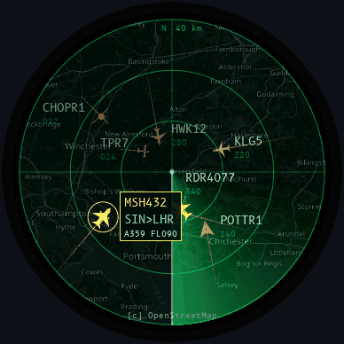
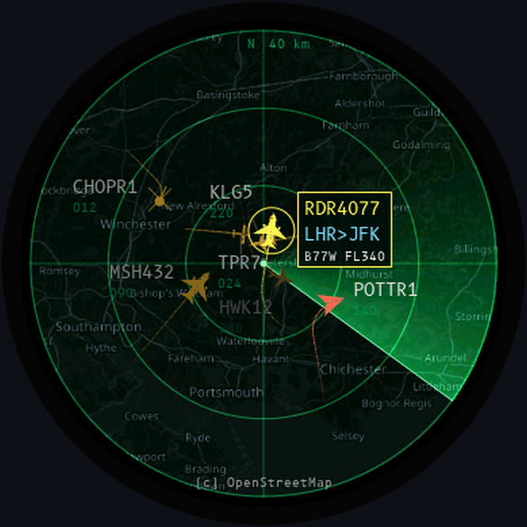
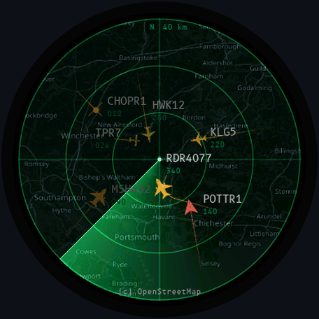
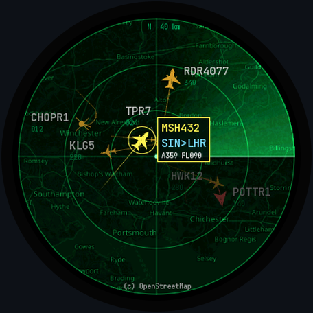
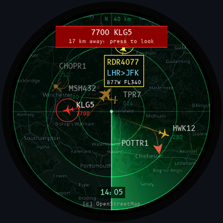
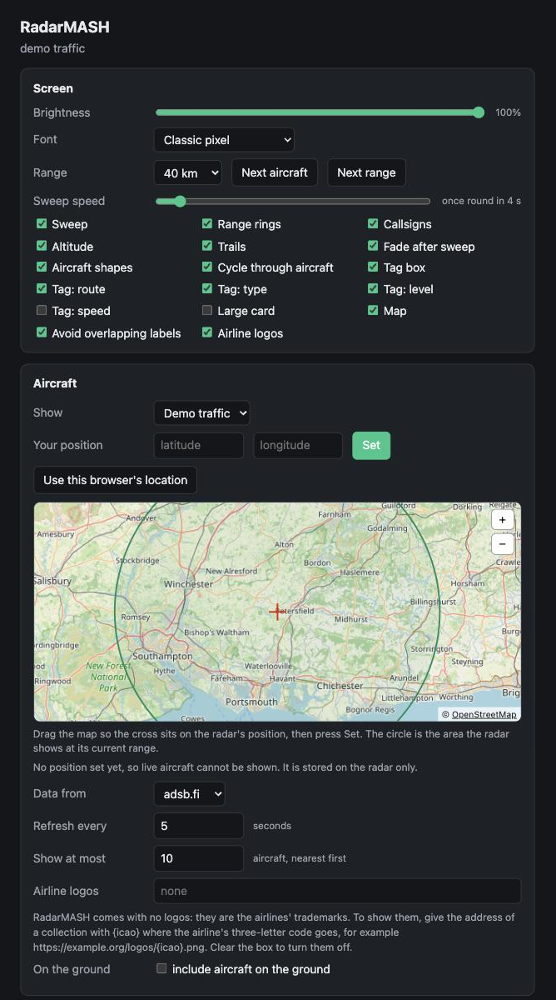
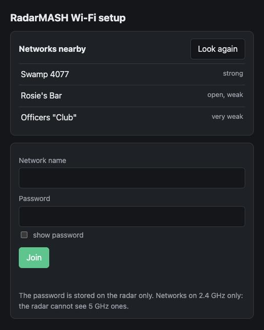
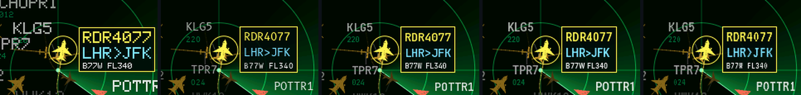

<h1 align="center">RadarMASH</h1>

  <b>Open firmware for the GeekMagic Radar 360.</b> 
  A real radar sweep, the aircraft over your house, and where they are going.

  
  
  

  

Straight from the simulator, which draws exactly what the device draws. Demo traffic; map © OpenStreetMap contributors.

The Radar 360 is a 2.1-inch round desk display that shows aircraft near you. RadarMASH replaces its firmware with one
you can read, change and trust: it tells you which flight is overhead, who operates it and where it is really going, over
a map of your own area, on a sweep that behaves like the real thing.

Named for Radar O'Reilly, who always heard the choppers first.

  <a href="https://github.com/jamielovelock/RadarMASH/releases/latest/download/radarmash-radar21en.bin"><b>⬇ Download the latest firmware</b></a>
  &nbsp;·&nbsp; <a href="#install">How to install</a>
  &nbsp;·&nbsp; <a href="#try-it-without-a-radar">Try it without a radar</a>

---

## What it looks like

<table>
  <tr>
    <td align="center"> A highlighted flight, with its route</td>
    <td align="center"> Trails follow each aircraft's real path</td>
    <td align="center"> Green map style</td>
  </tr>
  <tr>
    <td align="center" colspan="3"> An emergency squawk (demo traffic), and the clock</td>
  </tr>
</table>

## What it does

**A proper radar scope**
- A rotating sweep with a fading trail, at a speed you choose.
- Aircraft flash bright as the sweep passes and fade until it comes round again, like a real display.
- Range rings, and five ranges from 10 to 160 km on the button.
- The time of day, with the time zone worked out from where the radar is (or set by hand).
- Around 30 to 40 frames a second on the device.

**The aircraft, properly identified**
- Live positions from free community feeds, gliding smoothly between updates.
- Different shapes for light aircraft, single-aisle and twin-aisle airliners, helicopters and military aircraft.
- A tag box that steps through the aircraft in view: callsign, route, type, level and speed, your choice of which.
- Airline name, origin and destination, **checked for sense**. Route databases are often wrong, because flight numbers
  get reused. RadarMASH tests each route against where the aircraft is, which way it is heading and whether it is
  climbing or descending, asks a second source when the first does not fit, and shows nothing sooner than something wrong.
- Trails that follow the path actually flown, turns included.
- Labels that move out of each other's way when the sky gets busy.
- Airline logos beside the flight, in the tag box and on the large card, if you point it at a collection (none are
  bundled: see [Logos](#logos)).

**Emergencies, anywhere**
- An aircraft squawking 7700 (emergency), 7600 (radio failure) or 7500 is drawn in red with a pulsing ring.
- RadarMASH also keeps watch on the whole world for a 7700. When there is one, a notice flashes with the callsign and
  how far away it is. Press the button and the scope jumps there, map and all, and follows the aircraft; press again
  to come home. It comes home by itself when the emergency is over.

**A map of where you are**
- An underlay from standard web map tiles. OpenStreetMap works out of the box with no account or key.
- Dark and green styles made on the device from an ordinary light map, plus brightness and a sharper-detail option.
- Use any tile provider you like by pasting in its address.

**Yours to set up**
- One settings page for everything, served by the radar itself. Nothing to install, no app, no account.
- A draggable map to put the radar exactly where it lives.
- Five fonts, from chunky pixels to the typeface Airbus designed for cockpits.
- Every feature has its own switch.
- Settings are stored on the radar and survive restarts and power cuts.
- Map tiles and logos are kept on the radar too, so after a restart the picture is back at once and the map servers
  are not asked again.

**Careful with your device**
- Starts **on trial**: until you choose to keep it, any restart or power cycle returns to the firmware you came from.
- The original firmware stays on the device, one tap away.
- Wi-Fi setup through the radar's own hotspot, and a wrong password can never replace details that work.
- Checks the security certificates of the servers it talks to.
- Your position and Wi-Fi details stay on the radar. There is no cloud and no telemetry.

## The settings page

<table>
  <tr>
    <td align="center" valign="top"></td>
    <td align="center" valign="top"> Wi-Fi setup, reached through the radar's own hotspot</td>
  </tr>
</table>

### Fonts

Classic pixel · B612 Mono · JetBrains Mono · Roboto Condensed · VT323

## Install

> **Read this first.** The Radar 360's case is sealed and it has no USB data connection, so Wi-Fi is the only way to
> load firmware. RadarMASH is built around never leaving you stuck, but you are replacing the firmware on your own
> device at your own risk. It has been proven on one unit so far: model `radar21en`, coming from original firmware 0.4.41.

1. **Download** [`radarmash-radar21en.bin`](https://github.com/jamielovelock/RadarMASH/releases/latest/download/radarmash-radar21en.bin)
   from the [latest release](https://github.com/jamielovelock/RadarMASH/releases/latest). Use only this app image:
   never a bootloader, partition table or "factory" image.
2. **Upload it** on the original firmware's update page. If the radar has just started, wait a minute first; it
   refuses uploads until it has settled. From a terminal:

       curl -H 'Content-Type: application/octet-stream' --data-binary @radarmash-radar21en.bin http://YOUR-RADAR/api/ota

3. **Join its hotspot.** The screen shows a network called `RadarMASH-xxxx`. Join it from a phone, pick your Wi-Fi and
   enter the password. (If the page does not appear by itself, open `http://192.168.4.1`.)
4. **Open the settings page** at the address the setup page gives you, or `http://radarmash.local`, and drag the map to
   where you are. Aircraft appear within a few seconds.
5. **Live with it for a while.** It is still on trial: pull the plug and you are back on the original firmware.
   When you are happy, press **Keep this firmware** on the settings page.

**Going back.** Before you keep it, restart or power-cycle the radar. After you keep it, the original firmware is still
in the device's other slot: open `http://YOUR-RADAR/stock`, then restart.

**Updating RadarMASH later.** The settings page has an upload button. Be aware of what it does: the RadarMASH you are
running becomes the fallback, replacing the original firmware in the other slot, and the new version starts on trial.

### How it stays recoverable

- It never makes itself permanent. Until you confirm it, the device's own bootloader returns to the previous firmware
  on any reset.
- Left untouched for 30 minutes while on trial, it goes back by itself. Holding the button for 8 seconds does the same.
- Its updater writes only the other slot, and refuses images that are the wrong kind, too big or damaged.
- If it cannot join Wi-Fi it puts up the setup hotspot and keeps retrying the network it knows. Over that open hotspot
  only the Wi-Fi page can be reached, never the settings or the updater.

## Try it without a radar

The simulator runs the same drawing code on your computer and shows the round screen in a browser, with the same
settings page underneath. You need a C++17 compiler, `make` and `curl` (macOS or Linux).

    make -C sim run

Then open http://localhost:8360. It starts with made-up demo traffic. For real aircraft, set your position on the
settings page, or start it with:

    make -C sim run ARGS="--live --home LAT,LON"

To save a single frame: `sim/radarmash-sim --shot frame.bmp --t 9000 --select 0 --map`

## Where the data comes from

RadarMASH leans on free services run by enthusiasts. Please be gentle with them: the defaults are.

| What | From | Notes |
|---|---|---|
| Aircraft positions | [adsb.fi](https://adsb.fi), [adsb.lol](https://adsb.lol) | Refreshed every 5 seconds by default. If one stops answering, the other is used. |
| Airline and route | [adsbdb](https://www.adsbdb.com), then [hexdb](https://hexdb.io) | Looked up once per flight and checked against the aircraft. |
| Emergency watch | [adsb.fi](https://adsb.fi), [adsb.lol](https://adsb.lol) | Once a minute: is anyone, anywhere, squawking 7700? Can be switched off. |
| Time zone | [Open-Meteo](https://open-meteo.com) | Asked hourly, with your position rounded to about a kilometre. Set the zone by hand to avoid it. |
| Map | [OpenStreetMap](https://www.openstreetmap.org/copyright) by default | Its [tile usage policy](https://operations.osmfoundation.org/policies/tiles/) applies. Map data © OpenStreetMap contributors, shown on screen. |

### Logos

RadarMASH contains no airline logos: they are the airlines' trademarks, and not ours to give away. If you have a
collection you are entitled to use, put its address in **Airline logos** on the settings page, with `{icao}` where the
airline's three-letter code goes, for example `https://example.org/logos/{icao}.png`. The radar fetches each logo the
first time it is needed. Clear the box to turn them off.

## For developers

| Folder | What it is |
|---|---|
| `core/` | Portable C++: drawing, the radar screen, map, feeds, settings. No hardware dependencies. |
| `sim/` | Desktop simulator. Builds `core/` and serves the screen and settings page to a browser. |
| `firmware/` | Device firmware (PlatformIO, Arduino for ESP32-S3). Builds the same `core/`. |
| `web/` | The settings and Wi-Fi pages, embedded into both the simulator and the firmware. |
| `tests/` | Unit tests for `core/`. |
| `tools/` | Build helpers: image check, page embedding, font conversion. |

Because the simulator and the firmware share one drawing core, a change shows up on your desk in seconds and behaves
the same on the device.

**Build the firmware** with `firmware/build.sh` (needs [PlatformIO](https://platformio.org)). It produces
`radarmash-radar21en.bin` and checks it. No Wi-Fi details are compiled in.

**Tests**

    make test      # unit tests for the drawing code and radar behaviour
    make check     # what CI runs: the tests, then a simulator smoke test

The tests need only a C++ compiler. On every push the pipeline runs them with GCC and Clang under memory and
undefined-behaviour checking, builds the firmware, and checks the image. Pushing a version tag builds the image again and
attaches it to the release, so released images always come from the pipeline, never from someone's laptop.

One test matters more than the rest: the device has no room for a whole frame and draws the screen in narrow strips,
and that must give exactly the same picture as drawing it whole.

**The settings API** is plain JSON, the same on the simulator and the device:

    GET  /api/settings            everything, as one object
    POST /api/settings            any subset, e.g. {"trails": false, "range_km": 80}
    GET  /api/status              what the radar is doing
    POST /api/press, /api/hold    the button
    POST /api/alert-test          pretend there is an emergency for three minutes, to try the notice

Values out of range are clamped and anything unrecognised is ignored, so an old page and new firmware get along.

**Fonts** are bitmaps generated by `tools/make_fonts.py` (needs Pillow) into `core/fonts_data.cpp`, which is checked in.
Only fonts that may be redistributed in converted form under their own name are suitable.

## Known limits

- Proven on one radar. A second owner's experience would be valuable.
- The emergency watch covers 7700 only, and only what the community feeds can see: no coverage, no alert.
- Route checking catches routes that do not fit the aircraft; a wrong route that happens to look plausible still gets through.

## Licence and credits

GPL-3.0-or-later; see `LICENSE`. If you ship a modified RadarMASH, share your changes.

- The firmware links [PNGdec](https://github.com/bitbank2/PNGdec) (Apache-2.0), fetched at build time.
- The fonts in `core/fonts_data.cpp` are bitmaps of B612 Mono, JetBrains Mono, Roboto Condensed and VT323, each under
  the SIL Open Font License 1.1 (see `licenses/`).
- Two bundled files keep their own licences, reproduced inside them: `core/font5x7.h` (Adafruit GFX Library, BSD) and
  `sim/third_party/stb_image.h` (stb, public domain / MIT; simulator only).

RadarMASH is an independent hobby project. It is not affiliated with GeekMagic and contains none of their code, and it
has no connection with the makers of M\*A\*S\*H beyond affection.
